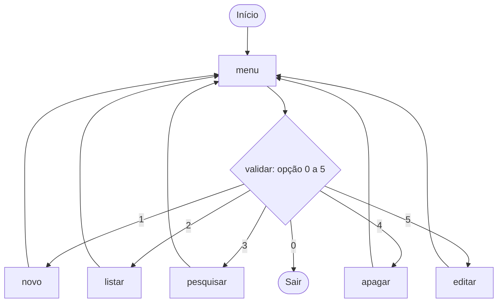
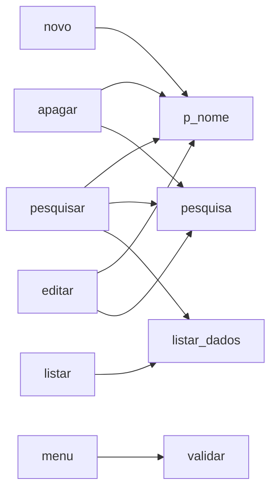

# 🏗️ Arquitetura da Agenda de Contatos

Documento técnico com a estrutura, o fluxo e as decisões do projeto.

## Estrutura de arquivos

```text
agenda-contatos-cli/
├── agenda.py        # Todo o programa (funções + programa principal)
├── README.md        # Apresentação do projeto
├── ARQUITETURA.md   # Este documento
└── .gitignore       # Arquivos que o Git deve ignorar
```

## Modelo de dados

A agenda é uma **lista global de listas**. Cada contato é uma lista de 3 posições:

```python
agenda = [
    ["Ana Souza",  "(34) 99999-1111", "ana@email.com"],   # índice 0
    ["Bruno Lima", "(34) 98888-2222", "bruno@email.com"], # índice 1
]
```

| Posição | Campo |
|:-------:|-------|
| `[0]` | Nome |
| `[1]` | Celular |
| `[2]` | E-mail |

## Fluxo do programa



O programa principal é um laço `while True` que chama `menu()` e despacha a opção para a função correspondente. O laço só termina quando o usuário escolhe `0`.

## Relação entre as funções



`pesquisa()` é a peça central: é a única que sabe **localizar** um contato, e é reaproveitada por `pesquisar()`, `apagar()` e `editar()`.

## Decisões de projeto

**Procedimentos x funções.** Quem apenas executa uma ação (imprimir, adicionar, apagar) é tratado como procedimento. Quem devolve um valor (`pesquisa`, `validar`, `menu`) é função. Cada bloco documenta isso no cabeçalho de comentário.

**`pesquisa()` devolve o índice, não o contato.** Com o índice em mãos é possível ler (`agenda[p]`), apagar (`del agenda[p]`) e substituir (`agenda[p] = ...`) usando a mesma busca. Quando nada é encontrado, devolve `None`.

**Busca sem diferenciar maiúsculas.** Nome digitado e nome salvo passam por `.lower()` antes de serem comparados, então `ana souza` encontra `Ana Souza`.

**Validação isolada em `validar()`.** O `try/except ValueError` fica em um só lugar. Entradas como letras ou texto vazio caem no `except`; números fora do intervalo recebem uma mensagem própria. O laço só termina com um valor válido.

**Lista global (`global agenda`).** Escolha simples e adequada ao escopo de estudo: todas as funções compartilham o mesmo estado sem precisar passá-lo por parâmetro.

## Limitações e evolução

| Limitação atual | Evolução possível |
|-----------------|-------------------|
| Dados só em memória, perdidos ao sair | Persistir em CSV/JSON ou SQLite |
| Identificação do contato pelo nome | Usar um `id` único por contato |
| Lista de listas (posições numéricas) | Dicionários ou classe `Contato` (POO) |
| Sem validação de e-mail e celular | Validar formato com `re` |
| Estado global | Encapsular em uma classe `Agenda` |
| Sem testes | Cobrir as funções com `pytest` |
